<!--
  Soheli-05 / Soheli-05  ·  GitHub profile README
  Design tokens: bg #080B12 · surface #101522 · violet #A78BFA · cyan #22D3EE · text #F8FAFC · muted #94A3B8
  All custom artwork lives in /assets (animated SVG). Replace every "REPLACE_" value before publishing.
-->


I build software applications and machine learning models with Java, Python and the modern web. 
I care about solid fundamentals, clean code, and interfaces that are easy to use.

 


 


 


<!-- PLACEHOLDER: replace REPLACE_PROJECT_1_REPO and REPLACE_PROJECT_1_LIVE_URL -->

<a href="https://github.com/Soheli-05/REPLACE_PROJECT_1_REPO"></a>

 

<!-- PLACEHOLDER: replace REPLACE_PROJECT_2_REPO and REPLACE_PROJECT_2_LIVE_URL (delete the demo button if there is no live demo) -->

<a href="https://github.com/Soheli-05/REPLACE_PROJECT_2_REPO"></a>

 

<!-- PLACEHOLDER: replace REPLACE_PROJECT_3_REPO and REPLACE_PROJECT_3_LIVE_URL -->

<a href="https://github.com/Soheli-05/REPLACE_PROJECT_3_REPO"></a>

 

 


 

<picture>
  <source media="(prefers-color-scheme: light)" srcset="https://raw.githubusercontent.com/Soheli-05/Soheli-05/output/github-snake.svg">
  
</picture>

 


 

 

<a href="https://leetcode.com/u/sohelipanda/">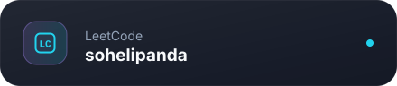</a>

 

